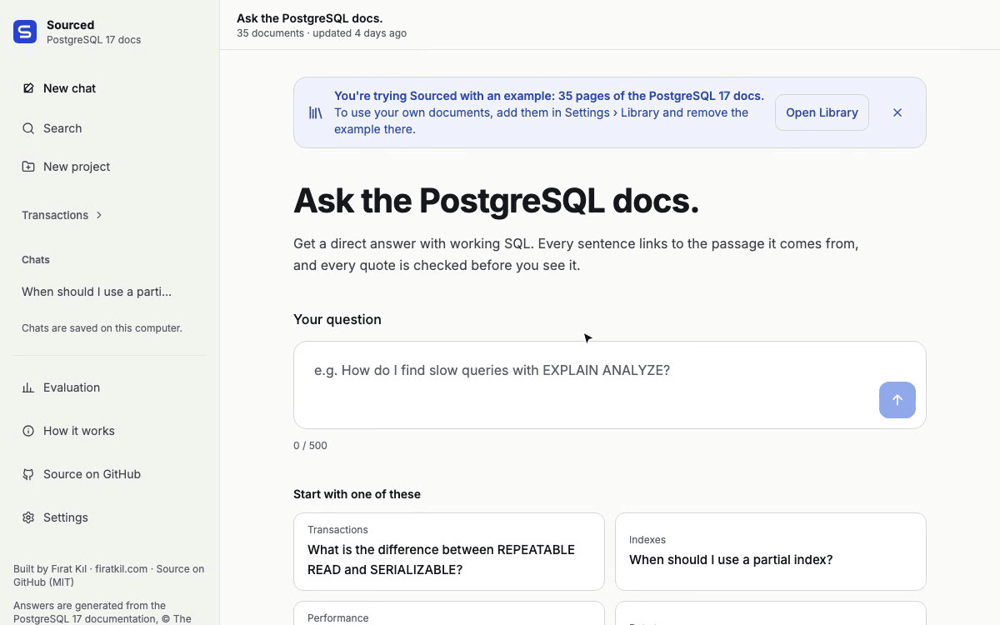

# Sourced

A small, production-quality RAG app and starter kit: every claim in the answer cites a passage, and every citation is checked on the server before you see it.

## Links

[Live demo](https://sourced.firatkil.com) · [Evaluation](https://sourced.firatkil.com/eval) · [How it works](https://sourced.firatkil.com/how-it-works) · [Guide](docs/GUIDE.md)

## Demo



## Quick start

You need two things:

- **Docker**: Docker Desktop on macOS or Windows, or Docker Engine with Compose on Linux. Docker is the only runtime prerequisite: the database (PostgreSQL with pgvector) runs inside Docker, so you install neither Node nor PostgreSQL.
- **An OpenAI API key** from [platform.openai.com/api-keys](https://platform.openai.com/api-keys). Other providers, and a fully local option with Ollama, are described under [Other providers](#other-providers).

**1. Get the code**

```sh
git clone https://github.com/firatkill/sourced.git
cd sourced
```

**2. Add your key**

```sh
cp .env.example .env.local
```

Open `.env.local` and paste your key after `OPENAI_API_KEY=`. That is the only line you have to fill in.

**3. Choose what to chat with**: the bundled example, or your own documents.

The first command builds the Docker image, which takes a few minutes once. Every command below starts the database by itself.

### Try the example

The repository includes 35 pages of the PostgreSQL 17 documentation. Your database starts empty, so index the example once (about $0.003 with OpenAI), then start the app:

```sh
./sourced ingest
./sourced dev
```

Open http://localhost:3000 and ask, for example, “When should I use a partial index?”

## Use your own documents

The example is configured as the default source. To start from your own documents, remove it first. `reset` deletes everything indexed and empties the source list; it asks before it deletes anything and never touches your files:

```sh
./sourced reset
```

Then add a folder of Markdown, HTML, PDF, Word (`.docx`) or plain-text files, or a website, index it and start the app:

```sh
./sourced add ./my-docs
./sourced ingest
./sourced dev
```

`ingest` prints the estimated cost before it sends anything to OpenAI, and stops to ask when the estimate is above $1. Run `./sourced ingest --dry-run` to see the estimate without indexing. Scanned PDFs need OCR first.

To go back to the example later, run `./sourced reset`, then `git checkout sourced.config.ts` and `./sourced ingest`.

Stop the app and the database with `./sourced down`; your data is kept for next time.

On Windows, use `sourced.cmd` instead of `./sourced` in Command Prompt, and `copy .env.example .env.local` instead of `cp`.

### With a coding agent

Open the folder in Claude Code or Codex and type `/setup`, or say “Set up a chatbot over my documents.” The agent runs the same commands, explains which provider receives your text and what it costs, and asks before it spends anything. Fill keys in `.env.local` yourself; never paste them into the chat.

| Command          | What it does                                                                          |
| ---------------- | ------------------------------------------------------------------------------------- |
| `/setup`         | Checks prerequisites, adds your documents, previews cost, indexes and starts the app. |
| `/add-docs`      | Adds a folder or website from your description and previews indexing.                 |
| `/ingest`        | Runs or resumes indexing and explains the health report.                              |
| `/check-quality` | Checks corpus health, helps you review test questions and runs evaluation.            |
| `/tune`          | Tries one configuration change, compares evaluation and keeps or reverts it.          |
| `/troubleshoot`  | Traces a wrong answer or a failed step and finds the likely cause.                    |

### Other providers

Google Gemini, Anthropic (answers only; it needs a separate embedding provider) and Ollama are supported. Put the provider's key in `.env.local` (the lines are in the file, commented out) and choose the models in `sourced.config.ts`. With Ollama for every role, nothing leaves your machine; it needs a running Ollama server with the models pulled, and no key. Changing the embedding model means indexing again: `ingest` tells you and asks first.

To try the app without any key, add `LLM_MODE=mock` to `.env.local`: answers and embeddings are stand-ins, so only use it to look around.

### If something goes wrong

- **A port is taken.** Set `SOURCED_PORT` (the app, default 3000) or `SOURCED_DB_PORT` (the database, default 5433) in `.env.local`.
- **“The existing index was built with …”.** You changed the embedding model, or the database holds an older index. `./sourced ingest` asks whether to rebuild it.
- **The app does not start.** `./sourced dev` prints the reason and the command to run next. `docker compose logs app` shows the full log.

Each checkout has its own database, so a second clone on the same machine starts empty.

## How it works

Sourced splits your documents into passages and stores them with their embeddings in PostgreSQL. For each question it combines vector and keyword search, reranks the candidates with the chat model and streams an answer from the best passages. The server checks every citation and quote against its passage, removes invalid ones and refuses when none remain. The [guide](docs/GUIDE.md) has the architecture, evaluation results, the Node path for contributors, privacy details and limits.

## License

MIT for code. Copyright (c) 2026 Fırat Kıl.

PostgreSQL 17 documentation, © The PostgreSQL Global Development Group, used under the [PostgreSQL License](corpus/postgres-17/LICENSE-POSTGRESQL.txt). See [NOTICE](corpus/postgres-17/NOTICE) for corpus attribution.

Built by Fırat Kıl · [firatkil.com](https://firatkil.com) · [GitHub](https://github.com/firatkill)
