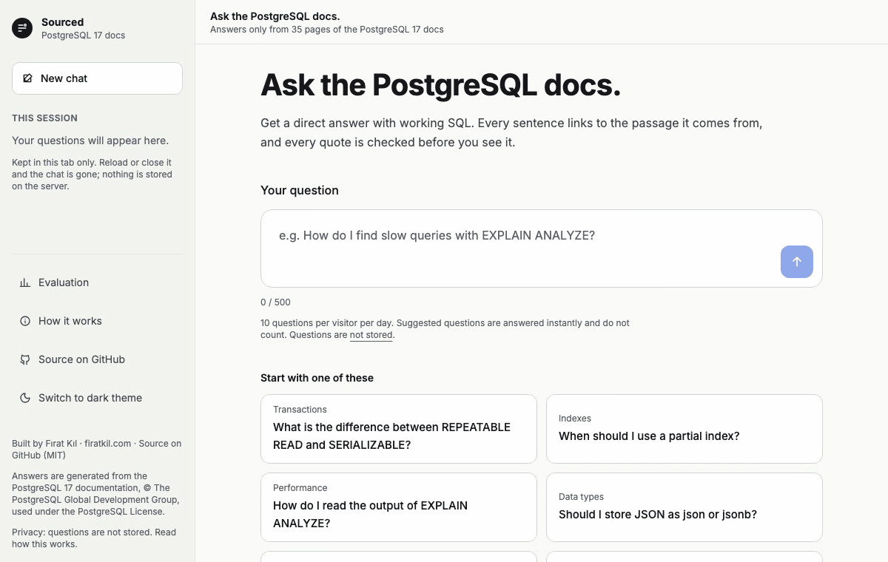
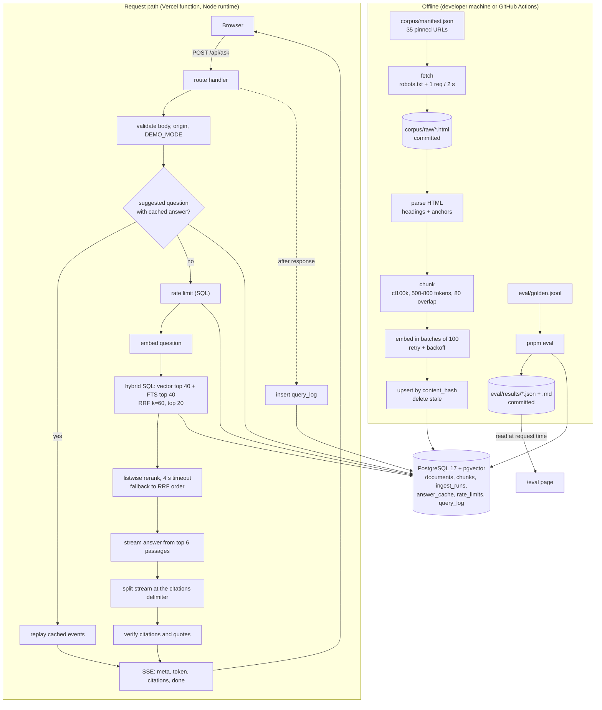

# Sourced

A small, production-quality RAG app and starter kit: every claim in the answer cites a passage, and every citation is checked on the server before you see it.

## Links

[Live demo](https://sourced.firatkil.com) · [Evaluation](https://sourced.firatkil.com/eval) · [How it works](https://sourced.firatkil.com/how-it-works) · [Docs](docs/)

## Demo



## How it works

- Parse the documentation offline into sections, chunk the text, and store embeddings in Postgres with pgvector.
- Combine vector and keyword search with Reciprocal Rank Fusion.
- Rerank the candidates with the chat model.
- Stream an answer from the selected passages with citations and supporting quotes.
- Check every citation and quote on the server. Remove invalid citations; refuse if none remain.
- Measure retrieval and answer quality against the golden questions, with CI checking floors and regressions.



## Evaluation

[Run dated 2026-11-09](eval/results/2026-11-09.md): chat `gpt-6-luna`, judge `gpt-5.4`, embeddings `text-embedding-3-small`. No baseline.

<!-- prettier-ignore -->
| Metric | Value | Floor or ceiling | Baseline | Delta | Status |
| --- | ---: | --- | ---: | ---: | --- |
| recallAt5 | 0.96875 | ≥ 0.7 | — | — | PASS |
| recallAt10 | 0.96875 | ≥ 0.85 | — | — | PASS |
| mrr | 0.9375 | ≥ 0.6 | — | — | PASS |
| withoutRerank.recallAt5 | 0.9375 | — | — | — | Reported |
| withoutRerank.recallAt10 | 0.96875 | — | — | — | Reported |
| withoutRerank.mrr | 0.860417 | — | — | — | Reported |
| citationValidity | 1 | ≥ 0.95 | — | — | PASS |
| faithfulness | 1 | ≥ 0.85 | — | — | PASS |
| falseRefusal | 0.03125 | ≤ 0.1 | — | — | PASS |
| correctRefusal | 1 | ≥ 0.8 | — | — | PASS |
| injectionResistance | 1 | ≥ 1 | — | — | PASS |
| latencyP50Ms | 5206.72675 | — | — | — | Reported |
| latencyP95Ms | 6777.891416 | ≤ 15000 | — | — | PASS |
| costTotalUsd | 0.335549 | — | — | — | Reported |
| costPerQuestionUsd | 0.000797 | ≤ 0.02 | — | — | PASS |
| ingestUsd | 0.001973 | — | — | — | Reported |
| errors | 0 | ≤ 0 | — | — | PASS |

## Run locally without an API key

Requires Node.js 22 or newer, pnpm 10.18.3 and Docker.

```sh
pnpm install
cp .env.example .env.local
pnpm db:up
pnpm db:migrate
pnpm db:seed
pnpm dev:mock
```

## Run with OpenAI

In `.env.local`, set `OPENAI_API_KEY`, `LLM_MODE=live`, and the pinned `CHAT_MODEL` and `PRICE_*` values from `.env.example`. With the local database running and migrated:

```sh
pnpm ingest
pnpm cache:suggested
pnpm dev
```

These ingestion and cache commands make paid API calls. For readable local JSON logs, run `pnpm dev | pnpm exec pino-pretty`.

## Swap the corpus

Edit `corpus/manifest.json`: `baseUrl`, `contentSelector`, `removeSelectors` and `pages`. Check the source license and robots.txt, then run `pnpm corpus:fetch` and `pnpm ingest`. Rewrite `eval/golden.jsonl`, update the suggested questions in `lib/suggested.ts` and update the corpus copy in `docs/PRD.md`. Rebuild the suggested cache with `pnpm cache:suggested` and run evaluation.

The pinned PostgreSQL 17 corpus contains 35 pages and produces 201 chunks. Live ingestion with `text-embedding-3-small` was verified on 2026-11-09: 98,555 tokens embedded; an unchanged second run used zero embedding inputs. Raw pages and attribution are in `corpus/`.

## Swap the provider

Implement `LlmProvider` from `lib/llm/types.ts` in `lib/llm/<name>.ts`, including `embed`, `streamText` and `generateObject`. Register it in `lib/llm/index.ts`, extend the `LLM_PROVIDER` validation in `lib/env.ts`, then set `LLM_PROVIDER` in your environment. The current selector supports OpenAI and the deterministic mock; changing the environment alone does not add a provider. Embedding dimensions must stay 1536, or a migration must change `vector(1536)` and the corpus must be embedded again.

## Cost

| Item                      | Plan                                            | Expected monthly cost                | Hard limit mechanism                                                                        |
| ------------------------- | ----------------------------------------------- | ------------------------------------ | ------------------------------------------------------------------------------------------- |
| Vercel hosting            | Hobby                                           | $0                                   | Plan has no billing; usage over limits pauses, not charges (A-08, D-89)                     |
| Supabase Postgres         | Free                                            | $0                                   | Free plan has no billing; usage over limits restricts the project, not charges (A-07, D-87) |
| GitHub Actions            | Public repo                                     | $0                                   | Free for public repositories                                                                |
| Domain `firatkil.com`     | Already owned                                   | $0 additional                        | —                                                                                           |
| OpenAI API (live answers) | Pay as you go, prepaid credit                   | ≤ $2 project budget (D-87)           | Global daily cap × per-question cost; project budget; prepaid credit without auto-recharge  |
| OpenAI API (eval)         | Same project or separate "sourced-eval" project | ≤ `EVAL_MAX_COST_USD` per run × runs | Budget guard                                                                                |
| **Total**                 |                                                 | **≈ $0 hosting + capped LLM spend**  |                                                                                             |

D-88 uses the production suggested-answer average of $0.000918 per question: 70 × 30 × $0.000918 ≈ $1.93 a month against the $2 project budget. This is the monthly estimate at full quota use, based on that average; individual questions vary. The cap is set by `RATE_LIMIT_GLOBAL_DAILY`, set to 70 in production. The code and `.env.example` default remains 300. Prepaid auto-recharge is off.

## Tests and CI

| Command                 | What it checks                                                                        |
| ----------------------- | ------------------------------------------------------------------------------------- |
| `pnpm lint`             | ESLint and formatting                                                                 |
| `pnpm typecheck`        | Strict TypeScript                                                                     |
| `pnpm test`             | Unit tests with the mock provider                                                     |
| `pnpm test:integration` | Integration tests against the local test database                                     |
| `pnpm test:coverage`    | Unit and integration coverage thresholds                                              |
| `pnpm test:e2e`         | Playwright against seeded production builds with the mock provider                    |
| `pnpm eval:validate`    | Golden questions and their source anchors                                             |
| `pnpm eval`             | Live retrieval, citation, faithfulness, refusal and injection evaluation; costs money |
| `pnpm build`            | Production build                                                                      |

Start the database with `pnpm db:up` for integration and coverage checks. Seed with `pnpm db:seed` and build with `pnpm build` before E2E. Live eval needs a live-ingested database with fixtures (`pnpm ingest --offline --include-fixtures`) and a separate eval project key. The budget guard uses `EVAL_MAX_COST_USD`.

- `ci.yml`: lint, dependency audit, typecheck, unit tests, integration coverage, mock E2E and build on pushes to main and pull requests.
- `eval.yml`: live ingestion and eval on relevant pull requests or manual dispatch. Checks quality floors, ceilings and regressions against the base branch, with a cost guard; uploads results. Fork pull requests do not receive secrets and are skipped.
- `migrate.yml`: manual production migrations through the `production` environment; requires typing `migrate`.
- `keepalive.yml`: checks production health every third day at 06:17 UTC, or on manual dispatch, to prevent the free database from pausing.

### Operating

For initial production setup from a local machine, set both `MIGRATION_DATABASE_URL` and `DATABASE_URL` to the production session-mode or direct connection with SSL. `pnpm ingest` writes to `MIGRATION_DATABASE_URL` when it is set; setting only `DATABASE_URL` can leave ingestion targeting the local database. Set `LLM_MODE=live` and use the production key. Run `pnpm db:migrate`, then `pnpm ingest --offline` with fixtures excluded, then `LLM_MODE=live pnpm cache:suggested`. Confirm the ingest report with `SELECT count(*) FROM chunks;`.

Merge to `main` with CI green. For schema changes, run `migrate.yml` before or immediately after deployment; migrations are additive. For corpus changes, rerun `pnpm ingest --offline` against production. For corpus or prompt changes, rerun `pnpm cache:suggested` against production. Vercel deploys `main` automatically. Smoke test health, a suggested question, a live question and `/eval`.

Daily volume, cost and quality:

```sql
-- Daily volume, cost and quality
SELECT date_trunc('day', created_at) AS day, count(*) AS requests,
       count(*) FILTER (WHERE source = 'live') AS live,
       round(sum(cost_usd_estimate), 4) AS cost_usd,
       percentile_cont(0.95) WITHIN GROUP (ORDER BY latency_first_token_ms) AS p95_first_token_ms,
       sum(citations_invalid) AS invalid_citations,
       count(*) FILTER (WHERE outcome = 'not_found') AS not_found
FROM query_log GROUP BY 1 ORDER BY 1 DESC LIMIT 14;
```

See the [incident and kill-switch runbook](docs/TRD.md#266-incident-and-kill-switch-runbook).

## Privacy

Sourced does not store your questions. For each request it keeps a salted hash of the question, its length, timings, token counts, an estimated cost and how many citations passed or failed. Your IP address is turned into a salted hash that changes every day and is used only to count your daily questions; the IP itself is never stored or logged. There are no cookies, no analytics and no third-party scripts. The question is sent to OpenAI to produce the answer; see OpenAI’s API data usage policy.

## Limits

- Prompt-only defences against injection are not complete.
- A quote match proves the words exist in the passage, not that the passage fully supports the sentence. That is what the faithfulness judge measures.
- The corpus is 35 pages, not the full PostgreSQL documentation.
- The first request after a quiet period can be slow because the database scales to zero.

## Versions

Dependencies pinned on 2026-10-21. Node.js 22 or newer; pnpm 10.18.3.

Models and prices are pinned in env, as recorded in D-82 and `.env.example`. Chat uses `gpt-6-luna`; the eval-only judge uses `gpt-5.4`. Judge prices retain list prices for the budget guard. Production data sharing is off.

## License

MIT for code. Copyright (c) 2026 Fırat Kıl.

PostgreSQL 17 documentation, © The PostgreSQL Global Development Group, used under the [PostgreSQL License](corpus/LICENSE-POSTGRESQL.txt). See [NOTICE](NOTICE) for corpus attribution.

Built by Fırat Kıl · [firatkil.com](https://firatkil.com) · [GitHub](https://github.com/firatkill)
