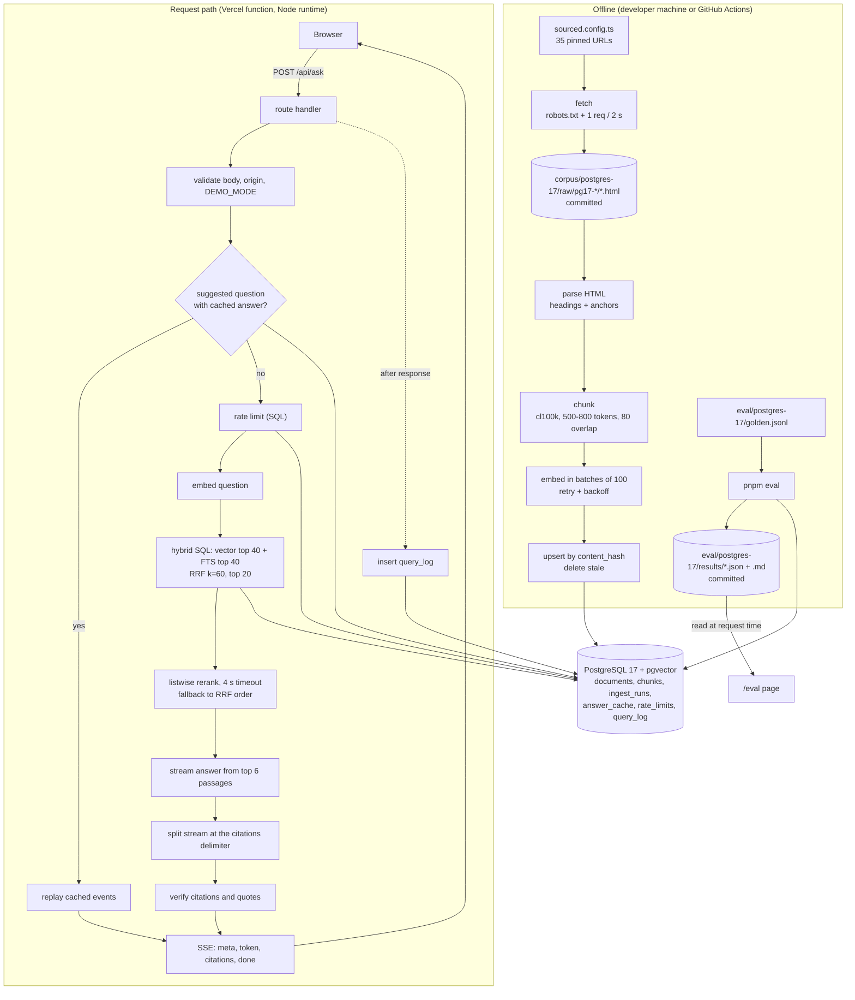

# Sourced guide

Everything the [README](../README.md) leaves out: how the pipeline works, how quality is measured, the Node path for contributors, and how the hosted example at sourced.firatkil.com is run.

## How it works

- Parse the documentation offline into sections, chunk the text, and store embeddings in Postgres with pgvector.
- Combine vector and keyword search with Reciprocal Rank Fusion.
- Rerank the candidates with the chat model.
- Stream an answer from the selected passages with citations and supporting quotes.
- Check every citation and quote on the server. Remove invalid citations; refuse if none remain.
- Measure retrieval and answer quality against the golden questions, with CI checking floors and regressions.



## Evaluation

[Run dated 2026-11-09](../eval/postgres-17/results/2026-11-09.md): chat `gpt-6-luna`, judge `gpt-5.4`, embeddings `text-embedding-3-small`. No baseline.

<!-- prettier-ignore -->
| Metric | Value | Floor or ceiling | Baseline | Delta | Status |
| --- | ---: | --- | ---: | ---: | --- |
| recallAt5 | 0.96875 | ≥ 0.7 | — | — | PASS |
| recallAt10 | 0.96875 | ≥ 0.85 | — | — | PASS |
| mrr | 0.9375 | ≥ 0.6 | — | — | PASS |
| withoutRerank.recallAt5 | 0.9375 | — | — | — | Reported |
| withoutRerank.recallAt10 | 0.96875 | — | — | — | Reported |
| withoutRerank.mrr | 0.860417 | — | — | — | Reported |
| citationValidity | 1 | ≥ 0.95 | — | — | PASS |
| faithfulness | 1 | ≥ 0.85 | — | — | PASS |
| falseRefusal | 0.03125 | ≤ 0.1 | — | — | PASS |
| correctRefusal | 1 | ≥ 0.8 | — | — | PASS |
| injectionResistance | 1 | ≥ 1 | — | — | PASS |
| latencyP50Ms | 5206.72675 | — | — | — | Reported |
| latencyP95Ms | 6777.891416 | ≤ 15000 | — | — | PASS |
| costTotalUsd | 0.335549 | — | — | — | Reported |
| costPerQuestionUsd | 0.000797 | ≤ 0.02 | — | — | PASS |
| ingestUsd | 0.001973 | — | — | — | Reported |
| errors | 0 | ≤ 0 | — | — | PASS |

## Sources, providers and profiles


Sources can be a folder or file glob, a sitemap, a same-origin crawl, a URL list or a local Git checkout (with its commit recorded). Formats: Markdown/MDX, HTML, PDF, `.docx` and plain text. Scanned PDFs need OCR before ingestion. See the [mixed-format files](../examples/mixed-folder/) and [MongoDB configuration](../examples/mongodb/sourced.config.ts). Check source licences and web crawling rules before adding a source.

Choose chat and embeddings separately in `sourced.config.ts`: OpenAI, Google Gemini and Ollama support both; Anthropic supports chat only. Changing the embedding model or dimensions requires re-ingestion. With Ollama for every role, text stays on your machine; configured web sources still require web fetches.

| Profile       | Behaviour                                                                                                                                                                                                          |
| ------------- | ------------------------------------------------------------------------------------------------------------------------------------------------------------------------------------------------------------------ |
| `local`       | Default for local development; no access token or demo quotas.                                                                                                                                                     |
| `private`     | Shared access token required. Initialization generates `SOURCED_ACCESS_TOKEN` in `.env.local`; enter it in the browser. A site-scoped cookie remembers access. Demo quotas and the suggested-answer cache are off. |
| `public-demo` | Public access with daily quotas, IP hashing, demo controls and cached suggested answers.                                                                                                                           |

## Setup and Settings in the browser

`./sourced dev` works on a fresh clone. The launcher creates an empty `.env.local` (mode 0600). The app's startup check writes a setup token to `.sourced/setup-token` (mode 0600) and, while no provider key is saved or nothing is indexed, the launcher prints `http://localhost:<port>/setup?token=…`. `./sourced setup` writes a new token and prints a new link; earlier links and signed-in browsers stop working.

What protects these pages, which can save keys and spend money:

- They exist only in the `local` profile; the hosted demo and the private profile have Appearance only.
- The port is bound to `127.0.0.1`, and the app refuses any `Host` other than `localhost`, `127.0.0.1` or `[::1]` (plus the hosts in `ALLOWED_ORIGINS`), which stops DNS rebinding.
- The link's token is exchanged for an `HttpOnly`, `SameSite=Strict` cookie that holds only the token's hash and lasts 30 days. Every setup and settings call needs it, and every change also needs an `Origin` naming the same host.
- Keys are checked with the provider's free list-models call, written to `.env.local` and the running server, and only ever returned masked (`sk-…a91F`). Error messages and logs never include them. `DATABASE_URL` and the ports are not editable in the browser.
- Nothing else goes to a provider until you confirm the cost on the Index step.

Indexing from the browser runs the same `ingest` as the CLI, one run at a time, and its progress comes from the database, so closing the tab does not stop it. Uploads go to `my-docs/` (ignored by Git) and use the folder source's types and 50 MB limit; for a large folder use `./sourced add <folder>`. Changing the embedding model in Settings shows the rebuild estimate first; after you confirm, it saves the model and rebuilds the index, and answers pause until the rebuild finishes. Answer and quality-check models apply to the next question without a restart.

## Node path (contributors)

Install Node.js 22 or newer and pnpm 10.18.3. The CLI is the same; run it through pnpm instead of the Docker launcher:

```sh
pnpm install --frozen-lockfile
cp .env.example .env.local
pnpm db:up
pnpm sourced ingest
pnpm sourced dev
```

Fill `OPENAI_API_KEY` as on the Docker path and uncomment the `DATABASE_URL` and `MIGRATION_DATABASE_URL` lines in `.env.local`; the Docker path sets them itself. `pnpm db:up` starts the same local PostgreSQL container (port 5433). `reset`, `add` and every other command work the same way. See [CONTRIBUTING.md](../CONTRIBUTING.md) for development checks.

To use a hosted PostgreSQL database with pgvector instead, set both `MIGRATION_DATABASE_URL` and `DATABASE_URL` to its connection, run `pnpm db:migrate`, then ingest with the Node CLI. The Docker CLI always uses its local database.

## Node path without an API key

This runs the bundled PostgreSQL example with mock answers. Requires Node.js 22 or newer, pnpm 10.18.3 and Docker.

```sh
pnpm install
cp .env.example .env.local
pnpm db:up
pnpm db:migrate
pnpm db:seed
pnpm dev:mock
```

## Node path with OpenAI

For the bundled PostgreSQL example, set `OPENAI_API_KEY` and `LLM_MODE=live` in `.env.local`. Model and price settings live in `sourced.config.ts`. With the local database running and migrated:

```sh
pnpm ingest
pnpm cache:suggested
pnpm dev
```

These ingestion and cache commands make paid API calls. For readable local JSON logs, run `pnpm dev | pnpm exec pino-pretty`.

## The PostgreSQL example corpus

Follow [Use your own documents](../README.md#use-your-own-documents) to configure sources and ingest them. Review golden questions for your corpus with `/check-quality`; update suggested questions and attribution in `sourced.config.ts`.

The pinned PostgreSQL 17 corpus contains 35 pages and produces 201 chunks. Live ingestion with `text-embedding-3-small` was verified on 2026-11-09: 98,555 tokens embedded; an unchanged second run used zero embedding inputs. Raw pages and attribution are in [`corpus/postgres-17/`](../corpus/postgres-17/).

## Cost of the hosted example

These figures describe the hosted PostgreSQL demo. Your corpus and configured models determine kit costs; use the ingestion dry run and evaluation budget guard.

| Item                      | Plan                                            | Expected monthly cost                | Hard limit mechanism                                                                        |
| ------------------------- | ----------------------------------------------- | ------------------------------------ | ------------------------------------------------------------------------------------------- |
| Vercel hosting            | Hobby                                           | $0                                   | Plan has no billing; usage over limits pauses, not charges (A-08, D-89)                     |
| Supabase Postgres         | Free                                            | $0                                   | Free plan has no billing; usage over limits restricts the project, not charges (A-07, D-87) |
| GitHub Actions            | Public repo                                     | $0                                   | Free for public repositories                                                                |
| Domain `firatkil.com`     | Already owned                                   | $0 additional                        | —                                                                                           |
| OpenAI API (live answers) | Pay as you go, prepaid credit                   | ≤ $2 project budget (D-87)           | Global daily cap × per-question cost; project budget; prepaid credit without auto-recharge  |
| OpenAI API (eval)         | Same project or separate "sourced-eval" project | ≤ `EVAL_MAX_COST_USD` per run × runs | Budget guard                                                                                |
| **Total**                 |                                                 | **≈ $0 hosting + capped LLM spend**  |                                                                                             |

D-88 uses the production suggested-answer average of $0.000918 per question: 70 × 30 × $0.000918 ≈ $1.93 a month against the $2 project budget. This is the monthly estimate at full quota use, based on that average; individual questions vary. The cap is set by `RATE_LIMIT_GLOBAL_DAILY`, set to 70 in production. The code and `.env.example` default remains 300. Prepaid auto-recharge is off.

## Tests and CI

| Command                 | What it checks                                                                        |
| ----------------------- | ------------------------------------------------------------------------------------- |
| `pnpm lint`             | ESLint and formatting                                                                 |
| `pnpm typecheck`        | Strict TypeScript                                                                     |
| `pnpm test`             | Unit tests with the mock provider                                                     |
| `pnpm test:integration` | Integration tests against the local test database                                     |
| `pnpm test:coverage`    | Unit and integration coverage thresholds                                              |
| `pnpm test:e2e`         | Playwright against seeded production builds with the mock provider                    |
| `pnpm eval:validate`    | Golden questions and their source anchors                                             |
| `pnpm eval`             | Live retrieval, citation, faithfulness, refusal and injection evaluation; costs money |
| `pnpm build`            | Production build                                                                      |

Start the database with `pnpm db:up` for integration and coverage checks. Seed with `pnpm db:seed` and build with `pnpm build` before E2E. Live eval needs a live-ingested database with fixtures (`pnpm ingest --offline --include-fixtures`) and a separate eval project key. The budget guard uses `EVAL_MAX_COST_USD`.

- `ci.yml`: lint, dependency audit, typecheck, unit tests, integration coverage, mock E2E and build on pushes to main and pull requests.
- `eval.yml`: live ingestion and eval on relevant pull requests or manual dispatch. Checks quality floors, ceilings and regressions against the base branch, with a cost guard; uploads results. Fork pull requests do not receive secrets and are skipped.
- `migrate.yml`: manual production migrations through the `production` environment; requires typing `migrate`.
- `keepalive.yml`: checks production health every third day at 06:17 UTC, or on manual dispatch, to prevent the free database from pausing.

### Operating the hosted example

The repository ships the `local` profile. The hosted example sets `SOURCED_PROFILE=public-demo` in its Vercel environment (production and preview), which runs the same `sourced.config.ts` with quotas, IP hashing, demo controls and cached suggested answers (D-138).

For initial production setup from a local machine, set both `MIGRATION_DATABASE_URL` and `DATABASE_URL` to the production session-mode or direct connection with SSL. `pnpm ingest` writes to `MIGRATION_DATABASE_URL` when it is set; setting only `DATABASE_URL` can leave ingestion targeting the local database. Set `LLM_MODE=live` and use the production key. Run `pnpm db:migrate`, then `pnpm ingest --offline` with fixtures excluded, then `LLM_MODE=live pnpm cache:suggested`. Confirm the ingest report with `SELECT count(*) FROM chunks;`.

Merge to `main` with CI green. For schema changes, run `migrate.yml` before or immediately after deployment; migrations are additive. For corpus changes, rerun `pnpm ingest --offline` against production. For corpus or prompt changes, rerun `pnpm cache:suggested` against production. Vercel deploys `main` automatically. Smoke test health, a suggested question, a live question and `/eval`.

Daily volume, cost and quality:

```sql
-- Daily volume, cost and quality
SELECT date_trunc('day', created_at) AS day, count(*) AS requests,
       count(*) FILTER (WHERE source = 'live') AS live,
       round(sum(cost_usd_estimate), 4) AS cost_usd,
       percentile_cont(0.95) WITHIN GROUP (ORDER BY latency_first_token_ms) AS p95_first_token_ms,
       sum(citations_invalid) AS invalid_citations,
       count(*) FILTER (WHERE outcome = 'not_found') AS not_found
FROM query_log GROUP BY 1 ORDER BY 1 DESC LIMIT 14;
```

See the [incident and kill-switch runbook](TRD.md#266-incident-and-kill-switch-runbook).

## Privacy

Outside the `public-demo` profile, saved chats keep their questions, answers and cited passages in the checkout's database; delete a chat from the sidebar or all of them with `./sourced reset --chats`. The hosted demo saves no chats. Separately, Sourced logs a salted question hash, length, timings, token counts, estimated cost and citation counts, not the question text. `STORE_QUESTIONS=true` opts into storing question text. The `public-demo` profile uses a daily-rotating salted IP hash for quotas; raw IP addresses are never stored or logged. The `private` profile sets one first-party access cookie. There are no analytics or third-party scripts.

Document text, passages and questions go only to the configured embedding, chat, rerank and judge providers. The hosted demo uses OpenAI. With Ollama for every role, they stay local; configured web sources still require web fetches.

## Limits

- Prompt-only defences against injection are not complete.
- A quote match proves the words exist in the passage, not that the passage fully supports the sentence. That is what the faithfulness judge measures.
- The demo corpus is 35 pages, not the full PostgreSQL documentation.
- The first request after a quiet period can be slow because the database scales to zero.

## Versions

Dependencies pinned on 2026-10-21. Node.js 22 or newer; pnpm 10.18.3.

The hosted demo models and prices are recorded in D-82 and `.env.example`; kit models and prices live in `sourced.config.ts`. The demo chat uses `gpt-6-luna`; the eval-only judge uses `gpt-5.4`. Judge prices retain list prices for the budget guard. Production data sharing is off.
